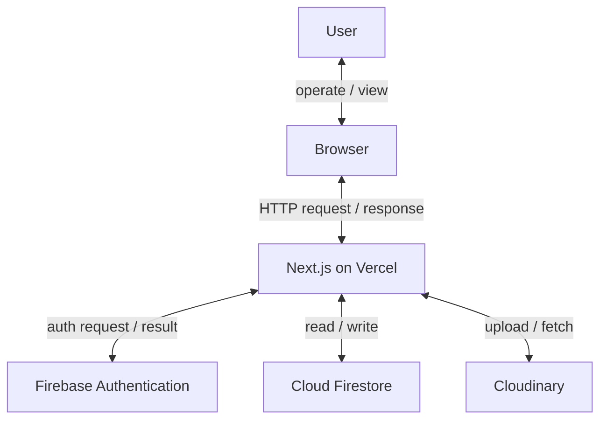

# Labelog Design Doc

## Context and scope

### Context
研究室のメンバーが近隣のお店情報やレビューを共有する手段がなく，口頭や個人のメモに頼っている状況がある．食べログのような既存サービスは外部に公開されており，研究室内だけのクローズドな情報共有には適していない．

そこで，研究室メンバーだけが利用可能なグルメ共有 Web アプリケーションとして， Labelog を開発することにした．

### Scope
このドキュメントでは，以下を対象とする．

- Labelog のシステム設計・技術選定の方針と根拠
- 認証・データ・画像ストレージの設計
- セキュリティ方針・ブランチ戦略

対象バージョン

- `labelog v0.1.0`

## Goals and non-goals

### Goals
- 研究室メンバーがお店情報・レビュー・写真を投稿・共有できる
- スマホのブラウザから快適に使えるよう，レスポンシブデザインに対応する
- 承認制によりグループ外からのアクセスを遮断する
- 卒業後も後輩に引き継いで継続利用できる

### Non-Goals
- 地図表示・場所検索機能（将来的に追加を検討）
- モバイルアプリ（iOS/Android）への対応
- 外部公開・SNS シェア機能
- レビューに対するコメント（将来的に追加を検討）
- プッシュ通知


## The actual design

### System-context-diagram

以下の図は，Labelog が外部サービスおよびユーザとどのようにやりとりするかを示す．



### APIs

本サービスは外部に公開する API を持たない．以下は，Next.js の API Routes として実装する内部 API である．

| エンドポイント | メソッド | 説明 |
|--------------|---------|------|
| /api/upload | POST | Cloudinary への画像アップロード（API Secret をサーバーサイドで処理） |

### Data storage

Firestore を使用する．以下の5つのコレクションで構成する．

#### users
| フィールド | 型 | 説明 |
|-----------|-----|------|
| uid | string | ユーザ ID |
| name | string | 表示名 |
| email | string | メールアドレス |
| gender | string  \| null | 性別 |
| birthDate | timestamp  \| null | 生年月日 |
| isApproved | boolean | 管理者による承認フラグ |
| role | string | ユーザ の役割（"admin" / "member"） |
| createdAt | timestamp | 登録日時 |
| updatedAt | timestamp | 最終更新日時 |

#### restaurants
| フィールド | 型 | 説明 |
|-----------|-----|------|
| id | string | ドキュメント ID |
| name | string | 店名 |
| address | string \| null | 住所 |
| genre | array | ジャンル |
| tags | array | タグ一覧 |
| businessHours | string \| null | 営業時間 |
| closedDays | string \| null | 定休日 |
| url | string \| null | 公式サイト・SNS |
| averageRating | number \| null | 平均評価 |
| reviewCount | number | レビュー数 |
| thumbnailPublicId | string \| null | サムネイル画像の public ID |
| isDeleted | boolean | 論理削除フラグ |
| createdAt | timestamp | 登録日時 |
| updatedAt | timestamp | 最終更新日時 |

#### favorites
| フィールド | 型 | 説明 |
|-----------|-----|------|
| id | string | ドキュメント ID |
| userId | string | ユーザの uid |
| restaurantId | string | お店の ID |
| createdAt | timestamp | お気に入り登録日時 |

#### reviews
| フィールド | 型 | 説明 |
|-----------|-----|------|
| id | string | ドキュメント ID |
| restaurantId | string | 対象のお店のID |
| userId | string | 投稿者のuid |
| rating | number | 星評価（1〜5） |
| text | string \| null | レビュー本文 |
| imagePublicIds | array | Cloudinary の画像 public ID 一覧 |
| likeCount | number | いいね数 |
| createdAt | timestamp | 登録日時 |
| updatedAt | timestamp | 最終更新日時 |

#### likes
| フィールド | 型 | 説明 |
|-----------|-----|------|
| id | string | ドキュメント ID |
| userId | string | ユーザーの uid |
| reviewId | string | レビューの ID |
| createdAt | timestamp | いいね日時 |

### Degree of constraint

以下の制約のもとで技術選定を行った．

- **開発体制**：一人開発のため，運用・保守のコストが低い構成を優先した
- **コスト**：無料枠内での運用を原則とする
- **ホスティング**：Vercel を使用することで，GitHub への push による自動デプロイを実現した
- **画像ストレージ**：Firebase Storage は無料枠での利用ができないため，25GB の無料枠を持ち，プライベート設定が可能な Cloudinary を採用した
- **長期運用**：卒業後も後輩に引き継げるよう，個人アカウントで管理する構成とした

## Alternatives Considered

### データベース：Firebase vs Supabase

Supabase は PostgreSQL ベースで SQL が使える点や，DB と Storage を一元管理できる点で魅力的だった．しかし，無料プランでは7日間アクセスがないとプロジェクトが自動停止する問題があり，研究室アプリとして長期安定運用が求められる本サービスには適さないと判断した．
Firebase は Spark（無料）プランで停止なしの永続稼働が保証されているため採用した．

### 画像ストレージ：Firebase Storage vs Supabase Storage vs UploadThing vs Cloudinary

Firebase Storage は2024年以降，新規プロジェクトでの Storage に Blaze プラン（従量課金）へのアップグレードが必要となり，課金の自動停止ができないリスクがあるため採用しなかった．
Supabase Storage は無料枠が 1GB と小さく，複数の写真投稿が想定される本サービスには容量が不足する可能性があるため採用しなかった．
UploadThing は無料プランでは画像 URL が公開状態となり，研究室内限定アプリとして画像の非公開化が必要なため採用しなかった．
Cloudinary は 25GB の無料枠・プライベート設定が無料から利用可能なため採用した．

## Cross-cutting concerns

### Security

#### Firestore セキュリティルール
- 承認済みユーザ（`isApproved: true`）のみ読み書きを許可する
- ユーザ自身のデータのみ編集・削除を許可する
- `admin` ロールを持つユーザのみお店・レビューの削除を許可する
- 未認証ユーザはすべてのアクセスを拒否する

#### Cloudinary のアクセス制御
- 画像は `type: 'private'` でアップロードし，元画像を保護する
- アクセス時はサーバサイドで API Secret を使って署名付き URL を生成する
- 画像の public ID は Firestore に保存し，認証済みユーザーにのみ提供する

#### 環境変数の管理
- `.env.local` にAPIキーを保存し，GitHub にはコミットしない
- Vercel のダッシュボードで本番環境の環境変数を管理する
- Cloudinary API Secret は NEXT_PUBLIC_プレフィックスを使わずサーバサイドのみで利用する

### Branch strategy

- `main`：本番環境．安定した完成品のみ置く
- `develop`：開発環境．feature ブランチで作った機能をここにまとめる
- `feature/xxx`：機能単位で切る作業ブランチ

開発の流れは以下の通りとする．

```
feature/xxx → develop → main
（作業）   （統合）   （本番）
```

### Error handling

- ネットワークエラーや Firestore へのアクセス失敗時はユーザにわかりやすいエラーメッセージを表示する
- 画像アップロード失敗時はリトライを促すメッセージを表示する
- 未承認ユーザがアクセスした場合は承認待ち画面にリダイレクトする

### Testing

現時点では自動テストは導入しない．開発が進んだ段階で以下を検討する．

- ユニットテスト：Vitest + React Testing Library
- E2Eテスト：Playwright

## Open Questions

- 地図表示・場所検索機能（Google Maps API）をいつ・どのように追加するか
- 管理者承認は当初Firebaseコンソールから直接 Firestore を編集して行う．
  - 将来的には，アプリ内の管理者ページでユーザ一覧を確認し，ロール・承認状態を変更できる画面に移行することを検討する
- 卒業時のアカウント・各サービスの引き継ぎ手順をどうするか

## Changelog

| 日付 | バージョン | 変更内容 |
|------|-----------|---------|
| 2026-04-26 | 0.1.0 | 初版作成 |
| 2026-04-26 | 0.1.1 | Branch strategy の修正 |
| 2026-05-01 | 0.2.0 | restaurants コレクションのフィールドを追加 |
