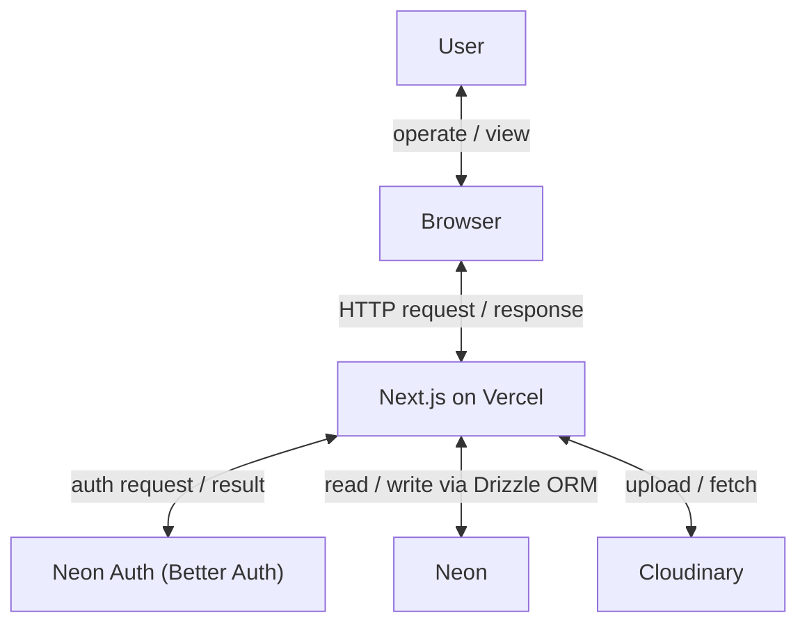

# Labelog Design Doc

## Context and scope

### Context

研究室のメンバが近隣のお店情報やレビューを共有する手段がなく，口頭や個人のメモに頼っている状況がある．食べログのような既存サービスは外部に公開されており，研究室内だけのクローズドな情報共有には適していない．

そこで，研究室メンバだけが利用可能なグルメ共有 Web アプリケーションとして，Labelog を開発することにした．

### Scope

このドキュメントでは，以下を対象とする．

- Labelog のシステム設計・技術選定の方針と根拠
- 認証・データ・画像ストレージの設計
- セキュリティ方針・ブランチ戦略

## Goals and non-goals

### Goals

- 研究室メンバがお店情報・レビュー・写真を投稿・共有できる
- スマホのブラウザから快適に使えるよう，レスポンシブデザインに対応する
- 承認制によりグループ外からのアクセスを遮断する
- 卒業後も後輩に引き継いで継続利用できる

### Non-Goals

- 地図表示・場所検索機能（将来的に追加を検討）
- モバイルアプリ（iOS/Android）への対応
- 外部公開・SNS シェア機能
- レビューに対するコメント（将来的に追加を検討）
- プッシュ通知

## The actual design

### System-context-diagram

以下の図は，Labelog が外部サービスおよびユーザとどのようにやりとりするかを示す．



### APIs

以下は，Next.js の Route Handlers として実装するアプリ用 API である．実装済みのものに加え，今後の追加・拡張予定を記載する．

#### 認証

| メソッド | パス | 説明 |
| --- | --- | --- |
| GET / POST | `/api/auth/[...path]` | Neon Auth による認証処理 |

#### ユーザ

| メソッド | パス | 説明 |
| --- | --- | --- |
| GET | `/api/users/me` | 自分の情報・承認状態・お気に入り公開設定を取得 |
| POST | `/api/users/me` | 初回ログイン後のユーザ初期化 |
| PATCH | `/api/users/me` | 自分のプロフィール・お気に入り公開設定を変更 |
| GET | `/api/users/{id}` | プロフィール表示用のユーザ情報を取得 |

#### ユーザ管理

| メソッド | パス | 説明 |
| --- | --- | --- |
| GET | `/api/admin/users` | ユーザ一覧・承認待ち一覧を取得 |
| PATCH | `/api/admin/users/{id}` | ユーザの承認・承認取消し |

#### 店舗

| メソッド | パス | 説明 |
| --- | --- | --- |
| GET | `/api/restaurants` | 店舗一覧を検索・絞り込み・ページ分割付きで取得 |
| POST | `/api/restaurants` | 店舗を登録 |
| GET | `/api/restaurants/{id}` | 店舗詳細・平均評価・レビュー数・自分のお気に入り状態を取得 |
| PATCH | `/api/restaurants/{id}` | 店舗情報を編集 |
| DELETE | `/api/restaurants/{id}` | レビューの有無と権限を確認して店舗を論理削除 |

#### レビュー

| メソッド | パス | 説明 |
| --- | --- | --- |
| GET | `/api/reviews` | 新着・店舗別・投稿者別のレビュー一覧を取得 |
| POST | `/api/reviews` | 店舗を指定してレビューを投稿 |
| GET | `/api/reviews/{id}` | レビュー詳細を取得 |
| PATCH | `/api/reviews/{id}` | 自分のレビューを編集 |
| DELETE | `/api/reviews/{id}` | 投稿者本人または管理者がレビューを削除 |

#### お気に入り

| メソッド | パス | 説明 |
| --- | --- | --- |
| GET | `/api/users/me/favorites` | 自分のお気に入り一覧を取得 |
| GET | `/api/users/{id}/favorites` | 公開設定に従って，その人のお気に入り一覧を取得 |
| PUT | `/api/users/me/favorites/{restaurantId}` | 店舗をお気に入りに登録 |
| DELETE | `/api/users/me/favorites/{restaurantId}` | お気に入りを解除 |

#### いいね

| メソッド | パス | 説明 |
| --- | --- | --- |
| GET | `/api/users/me/likes` | 自分がいいねしたレビュー一覧を取得 |
| PUT | `/api/users/me/likes/{reviewId}` | レビューにいいねを付ける |
| DELETE | `/api/users/me/likes/{reviewId}` | いいねを取り消す |

#### 画像

| メソッド | パス | 説明 |
| --- | --- | --- |
| POST | `/api/images` | レビュー写真・店舗サムネイルをアップロード |
| GET | `/api/images/{id}` | 権限を確認して画像を表示 |

### Data storage

Neon Postgres を使用し，テーブル定義と migration は Drizzle で管理する．

#### users

| フィールド | 型 | 説明 |
| ----------- | ----- | ------ |
| id | text | Neon Auth のユーザ ID |
| name | text | 表示名 |
| gender | gender (enum) \| null | 性別("male" / "female" / "other") |
| birth_date | date \| null | 生年月日 |
| is_approved | boolean | 管理者による承認フラグ．初期値は false |
| role | user_role (enum) | ユーザの役割("admin" / "member")．初期値は member |
| favorites_is_public | boolean | 承認済みメンバへのお気に入り公開設定．初期値は false |
| created_at | timestamptz | ユーザ登録日時 |
| updated_at | timestamptz | 最終更新日時 |

- 主キー: `id`

#### restaurants

| フィールド | 型 | 説明 |
| ----------- | ----- | ------ |
| id | uuid | 店舗 ID．自動生成 |
| name | text | 店名 |
| address | text \| null | 住所 |
| genre | text[] | ジャンル．初期値は空配列 |
| tags | text[] | タグ一覧．初期値は空配列 |
| business_hours | jsonb \| null | 曜日別の営業時間・定休日・不明状態．分割営業と翌日終了に対応 |
| business_hours_note | text \| null | 営業時間の補足 |
| url | text \| null | 公式サイト・SNS |
| thumbnail_image_id | uuid \| null | サムネイル画像 ID．images.id を参照 |
| is_deleted | boolean | 論理削除フラグ．初期値は false |
| created_at | timestamptz | 店舗登録日時 |
| updated_at | timestamptz | 最終更新日時 |

- 主キー: `id`
- 店舗削除は論理削除とする
- 平均評価・レビュー数は reviews から集計する

#### reviews

| フィールド | 型 | 説明 |
| ----------- | ----- | ------ |
| id | uuid | レビュー ID．自動生成 |
| restaurant_id | uuid | 店舗 ID．restaurants.id を参照 |
| user_id | text | 投稿者のユーザ ID．users.id を参照 |
| rating | smallint | 星評価．1〜5 の整数 |
| text | text \| null | レビュー本文 |
| created_at | timestamptz | 投稿日時 |
| updated_at | timestamptz | 最終更新日時 |

- 主キー: `id`
- レビューの削除は物理削除とする
  - 関連する likes・review_images も連動して削除する
- いいね数は likes から集計する

#### favorites

| フィールド | 型 | 説明 |
| ----------- | ----- | ------ |
| user_id | text | 登録したユーザ ID．users.id を参照 |
| restaurant_id | uuid | 店舗 ID．restaurants.id を参照 |
| created_at | timestamptz | お気に入り登録日時 |

- 主キー: (`user_id`, `restaurant_id`)
- お気に入りの解除は物理削除とする

#### likes

| フィールド | 型 | 説明 |
| ----------- | ----- | ------ |
| user_id | text | 登録したユーザ ID．users.id を参照 |
| review_id | uuid | レビュー ID．reviews.id を参照 |
| created_at | timestamptz | いいね日時 |

- 主キー: (`user_id`, `review_id`)
- いいねの解除は物理削除とする

#### images

| フィールド | 型 | 説明 |
| ----------- | ----- | ------ |
| id | uuid | 画像 ID．自動生成 |
| public_id | text | Cloudinary の public ID |
| user_id | text | アップロードしたユーザ ID．users.id を参照 |
| width | integer | 画像の幅(px) |
| height | integer | 画像の高さ(px) |
| created_at | timestamptz | アップロード日時 |

- 主キー: `id`

#### review_images

| フィールド | 型 | 説明 |
| ----------- | ----- | ------ |
| review_id | uuid | レビュー ID．reviews.id を参照 |
| image_id | uuid | 画像 ID．images.id を参照 |
| position | integer | レビュー内の表示順．0 から始まる |

- 主キー: (`review_id`, `image_id`)

### Degree of constraint

以下の制約のもとで技術選定を行った．

- **開発体制**：一人開発のため，運用・保守のコストが低い構成を優先した
- **コスト**：無料枠内での運用を原則とする
- **ホスティング**：Vercel を使用することで，GitHub への push による自動デプロイを実現した
- **画像ストレージ**：画像へのアクセスを承認済みメンバに限定できることを要件とする
- **長期運用**：卒業後も後輩に引き継げるよう，個人アカウントで管理する構成とした

## Alternatives Considered

### データベース・認証：Firebase vs Supabase vs Neon

当初は Cloud Firestore を採用した．その後，レビュー・ユーザ・店舗・画像などを組み合わせて取得する処理が多くなると考え，SQL の JOIN で関連データを取得しやすい PostgreSQL に変更した．
Supabase は PostgreSQL ベースで，DB・認証・Storage を一元管理できる点が魅力的だった．しかし，無料プランでは利用が少ないプロジェクトが自動停止するため，運用上の懸念から採用しなかった．
Neon は PostgreSQL を使用でき，本番・開発・テストの DB・認証環境をブランチごとに分離できるため採用した．認証には Neon Auth を使用する．

### 画像ストレージ：Firebase Storage vs Supabase Storage vs UploadThing vs Cloudinary

Firebase Storage は，無料の使用枠があるものの，従量課金の Blaze プランへの変更が必要なため採用しなかった．
Supabase Storage は無料枠が 1 GB と小さく，複数の写真投稿が想定される本サービスには容量が不足する可能性があるため採用しなかった．
UploadThing は無料プランでは画像 URL が公開状態となり，研究室内限定アプリとして画像の非公開化が必要なため採用しなかった．
Cloudinary は，画像変換と署名付き URL によるアクセス制御を利用できるため採用した．無料プランの 25 クレジットを，ストレージ・変換・転送量で共有する．

## Cross-cutting concerns

### Security

#### 認証・認可

- 認証には Neon Auth を使用し，通常のログインは Google OAuth で行う
- API の認証・権限チェックはサーバ側で行う
- 店舗・レビュー・お気に入り・いいね・画像の操作は，承認済みユーザに許可する
- 自分のユーザ情報の取得・初期化は，未承認でもログイン済みであれば許可する
- ユーザ本人による承認状態・ロールの変更は許可しない
- ユーザ管理 API は，承認済みかつ admin ロールを持つユーザに限定する
- 店舗の削除は，レビューがない場合は承認済みユーザ，レビューがある場合は管理者だけに許可する
- 削除済み店舗と，その店舗のレビューは通常の表示対象から除外する
- レビューの編集は投稿者本人，削除は投稿者本人または管理者に許可する
- お気に入りの登録・解除は本人に限定し，他人の一覧の取得は公開設定に従う
- いいねの登録・解除・一覧取得は本人に限定する

#### Cloudinary のアクセス制御

- 画像は `type: 'authenticated'` でアップロードし，元画像・変換後の画像を保護する
- 表示用の変換画像は，アップロード時に事前生成する
- `/api/images/{id}` で権限を確認し，サーバ側で署名付き URL を使って画像を取得して返す
- 未紐付けの画像は，アップロードした本人または管理者だけが参照できる
  - Cloudinary への画像保存は成功したものの，レビューや店舗情報の保存に失敗し，画像だけが残った場合などを想定する
- 画像の public ID は images テーブルに保存する

#### 環境変数の管理

- `.env.local`・`.env.test.local` は GitHub にコミットしない
- Vercel のダッシュボードで本番環境の環境変数を管理する
- DB 接続情報・Cookie の署名用シークレット・Cloudinary API Secret は，`NEXT_PUBLIC_` プレフィックスを付けず，サーバ側だけで使用する

### Branch strategy

#### Git Branch

- `main`：本番環境．安定した完成品のみ置く
- `develop`：開発環境．feature ブランチで作った機能をここにまとめる
- `feature/xxx`：機能単位で切る作業ブランチ

開発の流れは以下の通りとする．

```text
feature/xxx → develop → main
   (作業)      (統合)    (本番)
```

#### DB・認証環境

| 環境 | 接続先の Neon ブランチ |
| ------ | --- |
| ローカル開発 | develop |
| integration テスト | test |
| Vercel Preview・Development | develop |
| Vercel Production | main |

ローカル開発では，develop・feature ブランチで，Neon の develop ブランチの DB・Auth を共用する．
DB・Auth の接続先は環境変数で設定し，両方に同じ Neon ブランチを指定する．
ローカルで Git ブランチを切り替えても，接続先は変わらない．
スキーマの変更内容は migration ファイルとして Git で管理し，Neon の各ブランチに個別に適用する．

### Error handling

- 通信エラーや DB・認証サービスへのアクセス失敗時は，エラーメッセージを表示して再試行を促す
- 入力内容に誤りがある場合は，該当する項目とエラーメッセージを表示する
- 画面へのアクセス時，未ログインの場合は `/login`，未承認の場合は `/pending` にリダイレクトする
- 画像アップロード失敗時は，再試行を促すメッセージを表示する
- 予期しないエラーはサーバ側に記録し，クライアントには内部情報を含まないエラーメッセージを返す

### Testing

- unit テスト：Vitest で入力スキーマや Route Handler を検証する．コンポーネントの検証には，必要に応じて React Testing Library を導入する
- integration テスト：Playwright で実際の Neon DB・Auth に接続し，API の動作と権限制御を検証する
- E2E テスト：画面の実装に合わせて，Playwright でブラウザ操作による一連の動作を検証する

## Open Questions

- 地図表示・場所検索機能（Google Maps API）をいつ・どのように追加するか
- 管理者承認を，Neon Console での操作からアプリ内の管理者画面へいつ移行するか
- 卒業時のアカウント・各サービスの引き継ぎ手順をどうするか

## Changelog

| 日付 | バージョン | 変更内容 |
| ------ | ----------- | --------- |
| 2026-04-26 | 0.1.0 | 初版作成 |
| 2026-04-26 | 0.1.1 | Branch strategy の修正 |
| 2026-05-01 | 0.2.0 | restaurants コレクションのフィールドを追加 |
| 2026-11-20 | 0.3.0 | Neon への移行を反映し，API・データ設計・権限制御・テスト方針を更新 |
